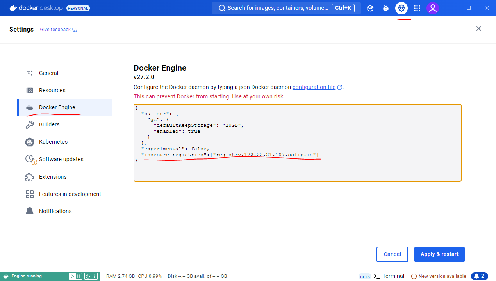

# Deploy DAD Project

**NOTE**: To run most of the command present in this tutorial we need to either be connected to our school network or use its [VPN](./vpn.md).

To deploy the project to our Kubernetes cluster we will need docker and `kubectl` (the Kubernetes cli) see the [tools tutorial](./tools.md) for installation instructions.

Each group has access to their own namespace on kubernetes so that the projects remain isolated.

> [!IMPORTANT]
> Given that you most likely already started working on our project and it might not have all the components testable, our suggestion is that you submit the provided code in the intermediate submission. Our goal is to make sure each group can deploy their project with all the components running. After the submission evaluation we can switch to using our own code.

## Prerequisites

Before we can publish our project there's some prerequisites we need to make sure we have. See the following sub-sections for instructions.

Add the config file you got via email on to `~/.kube/` and rename it to simply `config`. NOTE: if the .kube folder does not exist we need to create it.

Test your connection to the cluster.

```bash
kubectl get pods
```

## Prepare the Deployment

This tutorial assumes that we have our project in the following folder structure:

```bash
./                  -> Project Base
├── deployment      -> deployment files (Dockerfiles and Kubernetes Resources)
├── api             -> Laravel Project Root
├── api/deployment  -> Folder inside the Laravel project containing a Caddyfile
├── frontend        -> Vue Project Root
|── websockets      -> Node Web Sockets Project Root
```

The first task we need to do is find all the instances of the string `dad-group-x` replace the `x` with our group ID. This string is what allows our projects to be deployed to the proper [namespace](https://kubernetes.io/docs/concepts/overview/working-with-objects/namespaces/) on kubernetes.

### Tooling

The repository associated with these tutorials has all the commands defined in a `justfile`. [Justfile](https://github.com/casey/just) is a simplified version of a `Makefile` and we need to install it (instructions on the github page) we want to use it. Still on this tutorial we will see all the commands so that we can run them manually if we want.

Each group has access to their own namespace on kubernetes but they need to register the images and deployments with the proper reference to the group. That reference has the format **dad-group-X**, where X is the group number.

### Preparing Vue

In Vue's case we take advantage of the `.env` files support of Vite. The project has a `.env.development` and a `.env.production` file with the following variables (again X to be replaced with the group number):

```ini
# .env.development
VITE_API_URL=http://localhost:8000
VITE_WS_URL=http://localhost:3000


# .env.production
VITE_API_URL=http://api-dad-group-X-172.22.21.253.sslip.io
VITE_WS_URL=http://ws-dad-group-X-172.22.21.253.sslip.io
```

These values are included in the code at build time, so we need to build a new image if we change them.

### Preparing Laravel

The Laravel image runs with `APP_ENV=production`, which makes Laravel read its configuration from a `.env.production` file instead of our local `.env`. Git ignores this file, so we need to create it on the `api` folder before we build the image (X to be replaced with the group number):

```ini
# .env.production
APP_KEY=<output of the key:generate command>
APP_DEBUG=false
APP_URL=http://api-dad-group-X-172.22.21.253.sslip.io
```

To get a value for `APP_KEY` run this command in the `api` folder:

```bash
php artisan key:generate --show
```

## Deploy the code

To deploy our code to the cluster we need to build our container images locally, and push them to the container registry, that in our case lives at `registry-172.22.21.115.sslip.io`.

Present in the repository under the [code](https://github.com/ricardogomes/DAD-Tutorials/tree/main/code) folder is one called `deployment`. We are going to need those files.

Assuming we have a deployment folder in the same place as this tutorial repository we can run the next commands from the base of the full project. But check each command for the placement of the files and folders and change accordingly.

> [!IMPORTANT]
> One important **NOTE** is that Kubernetes will depend on us naming the versions of our apps to re-deploy them when we change our code, so keep in mind that we need to bump the version each time we want to push a new version of our applications.

### Configure Docker

Our Docker Registry does not use HTTPS so we need to inform Docker that this registry is only available on port 80.

This is the configuration we need (this is a JSON property to be included into either existing configuration or a new JSON config by wrapping it in { }):

```json

    "insecure-registries" : [ "registry-172.22.21.115.sslip.io" ]

```

On Windows and MacOS the simplest way is to configure this via Docker Desktop.



On linux we can edit the file directly via `sudo nano /etc/docker/daemon.json` and restart the service via `sudo systemctl restart docker`.

### Push Images to Container Repository

Build the Laravel Image (replace group with your group id - dad-group-X and the version with the current version - 1.0.0):

```bash
    docker build -t registry-172.22.21.115.sslip.io/{{group}}/api:v{{version}} --platform linux/amd64 \
    -f ./deployment/DockerfileLaravel ./api
```

Push the Laravel Image (replace group with your group id - dad-group-X and the version with the current version - 1.0.0):

```bash
docker push registry-172.22.21.115.sslip.io/{{group}}/api:v{{version}}
```

Build the Vue Image (replace group with your group id - dad-group-X and the version with the current version - 1.0.0):

```bash
docker build -t registry-172.22.21.115.sslip.io/{{group}}/web:v{{version}} --platform linux/amd64 -f ./deployment/DockerfileVue ./frontend
```

Push the Vue Image (replace group with your group id - dad-group-X and the version with the current version - 1.0.0):

```bash
docker push registry-172.22.21.115.sslip.io/{{group}}/web:v{{version}}
```

Build the Node WebSockets Image (replace group with your group id - dad-group-X and the version with the current version - 1.0.0):

```bash
docker build -t registry-172.22.21.115.sslip.io/{{group}}/ws:v{{version}} --platform linux/amd64 -f ./deployment/DockerfileWS ./websockets
```

Push the Node WebSockets Image (replace group with your group id - dad-group-X and the version with the current version - 1.0.0):

```bash
docker push registry-172.22.21.115.sslip.io/{{group}}/ws:v{{version}}
```

### Deploy Resources to Kubernetes Cluster

Before we can publish our Kubernetes resources we need to replace the string `dad-group-x` in each file with our actual group.

We can now deploy our resources:

```bash
kubectl apply -f deployment/
```

Check the deployment using:

```bash
kubectl get pods
```

Containers may take a bit to start, each one is ready when the `READY` column shows `1/1`. After that we should be able to reach our application at:

- Vue: [http://web-dad-group-x-172.22.21.253.sslip.io](http://web-dad-group-x-172.22.21.253.sslip.io)
- Laravel: [http://api-dad-group-x-172.22.21.253.sslip.io](http://api-dad-group-x-172.22.21.253.sslip.io)
- WebSockets: `http://ws-dad-group-x-172.22.21.253.sslip.io` (used by the Vue application)

### Create the Database

The provided API uses a SQLite database that lives inside the container, so we need to create it after the first deploy (see [Running commands](#running-commands) to get the pod name):

```bash
kubectl -n dad-group-X exec -it <pod-name> -- php artisan migrate:fresh --seed --force
```

> [!WARNING]
> The database is lost every time the Laravel pod is replaced, which happens when we deploy a new version or restart the deployment. We need to run the previous command again after each of those. To keep our data see [Using MySQL](#using-mysql).

### Verify the Deployment

With the database created we can check that all the components are working:

1. Open the Vue application and, on the _Laravel Test_ page, log in with `test@example.com` and the password `password`.
2. Use the menu to open the _WebSockets Test_ page and check that it shows `Connected`. Reloading the browser page logs us out, so we need to use the menu.
3. Open the application in a private window, log in with `second@example.com` (same password) and send a chat message between the two users.

### Using MySQL

For a database that keeps its data we can use the example in `deployment/extra_examples/kubernetes-mysql.yml`, which stores the data in a persistent volume. After replacing `dad-group-x` on that file we can deploy it:

```bash
kubectl apply -f deployment/extra_examples/kubernetes-mysql.yml
```

Next we add the connection to the `.env.production` file of our Laravel project:

```ini
DB_CONNECTION=mysql
DB_HOST=mysql
DB_PORT=3306
DB_DATABASE=project
DB_USERNAME=root
DB_PASSWORD=
```

Finally we build and deploy a new version of the Laravel image (see [Changing the applications](#changing-the-applications)) and [create the database](#create-the-database). From this point on we should only run `php artisan migrate --force` for new migrations, since `migrate:fresh` deletes all the data.

## Running commands

We sometimes need to run commands on the containers running in the cluster, one example are the Laravel commands (like migrate), we can do this by using these commands (X is the group number):

```bash

# get pod name
kubectl -n dad-group-X get pods -l app=laravel-app


kubectl -n dad-group-X exec -it <pod-name> -- php artisan migrate:fresh --seed --force

```

To redeploy the application stack you can run:

```bash

kubectl -n dad-group-X rollout restart deployment/laravel-app
kubectl -n dad-group-X rollout restart deployment/vue-app
kubectl -n dad-group-X rollout restart deployment/websocket-server
```

### Checking the Logs

To check the logs of a particular component we can run these commands:

```bash

kubectl get pods

# with the full pod name

kubectl logs <full-pod-name>

```

## Changing the applications

When you need to change the application code a new container image, with a new version must be built.

If you are using the just command, you can change the version variable at the top of the file, if not you need to run the docker build and docker push commands with the new version.

After that the new version can be defined in the appropriate kubernetes yaml file and run the command `kubectl apply -f deployment/`.
